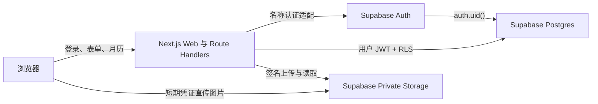

# AI 学习打卡网页第一期架构设计

状态：已由产品方确认

日期：2026-07-23

目标规模：约 100 名网页用户

## 1. 决策摘要

第一期采用 Supabase 一体化后端，保留当前 Cloudflare 网页部署：

- 前端：Next.js / React 网页应用。
- 可信业务层：Next.js Route Handlers 与服务端模块。
- 身份：Supabase Auth。
- 关系数据：Supabase Postgres。
- 图片：Supabase Private Storage。
- 正式用户主键：不可变 UUID `user_id`。
- 用户可见认证：名称 + 密码。
- 注册：开放注册，不使用邀请码。
- 密码恢复：一次性展示的高熵恢复码。
- 正式打卡：必须联网写入云端。
- 离线能力：只保留未提交草稿，不自动同步。
- 首期不包含：管理后台、管理员角色、邀请码、社区、勋章和云端草稿。

当前 IndexedDB 记录可在用户建立云端账号后一次性导入，原本地数据不会被删除。

## 2. 目标

### 2.1 产品目标

- 用户可通过名称和密码注册、登录并恢复账号。
- 用户可按日期新增、编辑和回看 AI 学习打卡。
- 一个用户一天最多保存一条正式打卡。
- 图片和打卡内容在用户之间严格隔离。
- 刷新、换浏览器或换设备后，可读取同一账号的云端记录。
- 现有浏览器数据可安全、幂等地迁移到云端。

### 2.2 工程目标

- 将当前集中在 `app/attention-app.tsx` 的界面、业务和存储逻辑拆成边界清晰的 feature 模块。
- 浏览器不持有 Supabase secret/service-role key。
- 普通数据访问使用当前用户 JWT，让 RLS 成为最终隔离边界。
- 数据库结构、函数、约束和 RLS 全部通过版本化 SQL migration 管理。
- 错误不会清空表单；网络故障不会吞掉未提交内容。

## 3. 非目标

第一期明确不建设：

- 邀请注册和邀请码管理。
- 管理后台、用户停用和人工重置密码。
- 微信、邮箱或手机号登录。
- 社区、关注、评论、排行榜和公开资料页。
- 勋章或积分奖励。
- 多图片、附件管理或富文本编辑器。
- 离线完成正式打卡或自动后台同步。
- 独立微服务、消息队列和搜索服务。

## 4. 总体架构



系统是一个模块化单体。约 100 名用户不需要独立后端项目或微服务。Next.js 是唯一可信业务入口；Supabase 负责身份、持久数据和私有文件。

浏览器只保存：

- Supabase SSR 会话 Cookie。
- 当前界面状态。
- 以 `user_id + checkin_date` 隔离的未提交 IndexedDB 草稿。
- 旧版 IndexedDB 数据和迁移完成标记。
- 静音等非敏感偏好。

浏览器不保存：

- 密码或恢复码。
- service-role/secret key。
- 作为唯一正式来源的完整打卡数据库。

## 5. 前端架构

### 5.1 路由边界

```text
app/
  (auth)/
    login/
    register/
    recover/
  (app)/
    page.tsx
  api/
    auth/
    checkins/
    uploads/
```

- `(auth)`：登录、注册、密码恢复和恢复码轮换。
- `(app)`：个人学习工作区。未登录用户由服务端守卫跳转到登录页。
- 不创建 `(admin)` 路由。
- 认证路由和个人工作区均设置为动态响应，禁止 CDN/ISR 缓存用户会话响应。

### 5.2 Feature 模块

```text
features/
  auth/
  calendar/
  checkins/
  drafts/
  migration/
  profile/
lib/
  api/
  validation/
  supabase/
server/
  auth/
  checkins/
  storage/
  rate-limit/
```

主要组件：

- `AppHeader`：名称、头像、连续天数、累计记录、恢复码入口和退出。
- `MonthCalendar`：月份切换、日期状态和最多两行 attention 摘要。
- `CheckInEditor`：选中日期、保存状态、表单字段和底部操作栏。
- `ImageNoteUploader`：图片压缩、预览、替换和删除。
- `DirtySwitchDialog`：保存并切换、放弃修改、取消。
- `RecoveryCodeDialog`：只展示当前刚生成的恢复码，支持复制和下载。
- `LegacyImportDialog`：展示可迁移记录和图片数量，并报告导入结果。

### 5.3 状态管理

- TanStack Query 管理云端记录、月份摘要、加载、错误和缓存失效。
- 表单值、`isDirty`、选中日期和确认框状态保留在打卡 feature 内。
- 不引入全局状态库。
- Zod Schema 共享字段定义和前端提示；服务端必须再次校验。
- IndexedDB 草稿存文字和待上传图片 Blob，成功提交后删除对应草稿。
- 断网恢复后只刷新云端状态，不自动提交草稿。

## 6. 认证设计

### 6.1 名称与 Supabase Auth 的映射

Supabase Auth 底层仍使用内部邮箱和密码，但用户永远不需要输入或查看邮箱。

注册流程：

1. 客户端提交名称、头像和密码。
2. 服务端执行限流和字段校验。
3. 名称执行 NFKC 规范化、首尾去空格并合并连续空格。
4. 服务端生成随机内部邮箱，例如 `<random-uuid>@internal.invalid`。
5. 服务端生成 130-bit 恢复码。
6. 使用独立的服务端 admin client 创建已确认的 Auth 用户。
7. 调用仅授予 service role 的数据库函数，在一个数据库事务内写入 `profiles` 和 `private.login_aliases`。
8. 若第 7 步失败，服务端删除刚创建的 Auth 用户作为补偿。
9. 使用普通 SSR client 执行密码登录并写入会话 Cookie。
10. 向用户只展示一次恢复码。

登录流程：

1. 客户端提交名称和密码。
2. 服务端限流并规范化名称。
3. service-role RPC 从私有映射中解析内部邮箱。
4. 普通 SSR client 调用 Supabase `signInWithPassword`。
5. 成功后跳转个人工作区；失败统一返回“名称或密码不正确”，避免枚举账号。

`user_id` 是所有业务数据主键。名称可修改时，服务端在同一事务中更新公开名称和私有登录别名，不改变 `user_id` 或历史记录。

### 6.2 名称和密码规则

- 名称规范化后长度为 1-20 个 Unicode 字符。
- 名称唯一性不区分拉丁字母大小写，由 `citext` 唯一约束最终保证。
- 名称不得包含控制字符或换行。
- 密码长度为 8-72 个字符。
- 密码不做 trim、大小写转换或 Unicode 规范化。
- 前端强度提示不替代服务端校验。

### 6.3 会话

- 使用 `@supabase/ssr` 的 Cookie 会话与 PKCE 默认流程。
- Cookie 使用 `Secure`（生产环境）和 `SameSite=Lax`。
- 富客户端需要读取和刷新 Supabase token，因此本设计不承诺 Auth Cookie 为 HttpOnly。
- 通过严格 CSP、输入转义、依赖审计和禁止注入 HTML 降低 XSS 风险。
- 会话刷新响应必须带 `Cache-Control: private, no-store`，认证页面和用户页面不得使用 ISR。
- 普通请求使用用户 JWT 创建 request-scoped Supabase client。
- admin client 只用于注册、名称解析和密码恢复，实例不能导出到浏览器代码。

## 7. 恢复码设计

恢复码采用 26 位 Crockford Base32，约 130-bit 随机熵。显示时分组以便人工保存，比较前移除连字符并统一大写。

数据库只保存 `SHA-256(normalized_recovery_code)` 的 `bytea` 摘要。高熵随机码不依赖用户记忆，因此无需保存可还原密文。

密码恢复流程：

1. 用户提交名称、恢复码和新密码。
2. 服务端按 IP 与规范化名称限流。
3. service-role RPC 在私有 schema 内校验名称和摘要。
4. 校验成功后，admin client 修改 Auth 密码。
5. 服务端生成新恢复码并原子替换旧摘要。
6. 旧恢复码立即失效。
7. 使用新密码建立会话，并只展示一次新恢复码。

登录状态下允许主动轮换恢复码。轮换前要求用户重新输入当前密码，成功后替换摘要并只展示一次新码。

恢复码原文不得进入：

- 数据库。
- 日志。
- 分析事件。
- URL 查询参数。
- localStorage 或 IndexedDB。

## 8. API 契约

所有接口返回一致结构：

```ts
type ApiSuccess<T> = { ok: true; data: T; requestId: string };
type ApiFailure = {
  ok: false;
  error: {
    code: string;
    message: string;
    field?: string;
    retryAfterSeconds?: number;
  };
  requestId: string;
};
```

认证接口：

- `POST /api/auth/register`
- `POST /api/auth/login`
- `POST /api/auth/logout`
- `POST /api/auth/recover`
- `POST /api/auth/recovery-code/rotate`
- `GET /api/me`
- `PATCH /api/me`：修改头像；修改登录名称时要求重新输入当前密码。

打卡接口：

- `GET /api/checkins?month=YYYY-MM`：返回当月日期、attention、是否有图、版本和更新时间。
- `GET /api/checkins/:date`：返回某日完整记录。
- `PUT /api/checkins/:date`：新建或按 `version` 更新记录。
- `POST /api/uploads/checkin-image`：校验用户和日期后返回短期上传凭证及服务器指定路径。
- `DELETE /api/uploads/checkin-image`：清理尚未关联或被用户移除的本人图片。

认证限流采用以下第一期默认值：

- 注册：同一 IP 每小时最多 5 次。
- 登录失败：同一 IP 与规范化名称组合每 15 分钟最多 10 次。
- 密码恢复：同一 IP 与规范化名称组合每 30 分钟最多 5 次。
- 登录状态下轮换恢复码：同一用户每小时最多 5 次。

超过阈值后返回 `429 RATE_LIMITED` 和剩余等待秒数。成功登录可清除对应登录失败 bucket；注册和恢复 bucket 到窗口结束后清除。

图片保存顺序：

1. 浏览器压缩图片。
2. 请求短期上传凭证。
3. 浏览器直传私有 Storage。
4. `PUT /api/checkins/:date` 写入图片路径。
5. 成功后清理旧图片；数据库失败时尽力清理新上传的孤立图片。

## 9. 数据模型

### 9.1 `public.profiles`

| 字段 | 类型 | 约束 |
| --- | --- | --- |
| `id` | `uuid` | PK，FK `auth.users(id)`，级联删除 |
| `display_name` | `varchar(20)` | 非空 |
| `avatar_key` | `smallint` | 非空，值为 1-5 |
| `created_at` | `timestamptz` | 非空，默认 `now()` |
| `updated_at` | `timestamptz` | 非空，自动更新 |

第一期没有 `role`、`status` 或 `must_change_password` 字段。

### 9.2 `private.login_aliases`

| 字段 | 类型 | 约束 |
| --- | --- | --- |
| `user_id` | `uuid` | PK，FK `auth.users(id)`，级联删除 |
| `login_name` | `citext` | 非空、唯一 |
| `auth_email` | `text` | 非空、唯一 |
| `recovery_code_digest` | `bytea` | 非空 |
| `recovery_rotated_at` | `timestamptz` | 非空 |
| `created_at` | `timestamptz` | 非空 |
| `updated_at` | `timestamptz` | 非空 |

`private` schema 不暴露给 Data API。仅 service-role 专用的 Security Definer 函数可访问。

### 9.3 `public.check_ins`

| 字段 | 类型 | 约束 |
| --- | --- | --- |
| `id` | `uuid` | PK，默认 `gen_random_uuid()` |
| `user_id` | `uuid` | FK `auth.users(id)`，非空、级联删除 |
| `checkin_date` | `date` | 非空 |
| `attention` | `varchar(120)` | 非空 |
| `source_url` | `text` | 可空，仅允许 HTTP/HTTPS，最长 2048 |
| `summary` | `text` | 非空，最长 5000 |
| `inspiration` | `text` | 非空，最长 2000 |
| `image_path` | `text` | 可空 |
| `image_name` | `varchar(255)` | 非空，默认空字符串 |
| `version` | `integer` | 非空，默认 1 |
| `created_at` | `timestamptz` | 非空 |
| `updated_at` | `timestamptz` | 非空，自动更新 |

约束与索引：

- `UNIQUE(user_id, checkin_date)`。
- `INDEX(user_id, checkin_date DESC)`。
- `attention` 至少包含一个非空白字符。
- `version >= 1`。
- 更新时 `version = version + 1`。

连续天数和累计记录由查询计算，不保存冗余计数。

### 9.4 `private.auth_rate_limits`

该表为应用级限流兜底，不保存原始 IP 或名称：

- `bucket_digest bytea`
- `action text`
- `window_started_at timestamptz`
- `attempt_count integer`
- `blocked_until timestamptz`

键由服务端对“动作 + IP + 规范化名称”做带服务端 pepper 的 HMAC 生成。注册、登录和恢复分别使用独立窗口。过期 bucket 可定期惰性清理。

## 10. RLS 与 Storage

### 10.1 `profiles`

- 启用 RLS。
- 登录用户只能读取 `id = auth.uid()` 的档案。
- 档案修改通过服务端接口完成。
- `authenticated` 角色没有修改角色或系统字段的能力，因为第一期不存在这些字段。

### 10.2 `check_ins`

对 SELECT、INSERT、UPDATE、DELETE 分别建立策略：

```sql
(select auth.uid()) = user_id
```

写入同时使用 `WITH CHECK`。Route Handler 使用当前用户的 SSR Supabase client，而不是 service-role client，因此即使业务代码漏掉用户条件，RLS 仍会阻止越权。

### 10.3 Storage

- Bucket：`checkin-images`。
- Bucket 类型：private。
- 路径：`<user_id>/<checkin_date>/<random-uuid>.<ext>`。
- 第一段目录必须等于 `auth.uid()::text`。
- 允许 `image/jpeg`、`image/png` 和 `image/webp`。
- 原始选择上限 10 MB。
- 浏览器压缩至最长边 1600 px，目标文件不超过 2 MB。
- 图片通过短期签名 URL 或经过身份校验的 Storage API 读取。

第一期每条打卡只关联一张图片。

## 11. 保存与并发

新记录的 `version` 为 1。编辑记录时客户端提交最后读取到的 `version`。

服务端更新条件包含：

```text
user_id = current_user
checkin_date = requested_date
version = submitted_version
```

无匹配行时返回 `409 VERSION_CONFLICT` 和当前云端记录。界面提供：

- 载入云端版本。
- 在预览云端更新时间后，明确选择覆盖；覆盖请求使用最新云端 `version`，不提供无条件写入。

保存成功后：

- 更新 TanStack Query 的月摘要和单日缓存。
- 清除该用户、该日期的 IndexedDB 草稿。
- 更新连续天数和累计记录。
- 首次创建记录播放一次完成反馈；普通修改只显示轻量成功提示。

## 12. 本地草稿

草稿键由 `user_id + checkin_date` 组成，内容包括：

- attention。
- source URL。
- summary。
- inspiration。
- 待上传图片 Blob 与文件名。
- 基于哪个云端 `version` 开始编辑。
- 最后修改时间。

编辑后防抖写入 IndexedDB。以下情况不得清除草稿：

- 会话过期。
- 断网。
- 图片上传失败。
- 服务器错误。
- 版本冲突。

联网恢复后只刷新云端记录并显示“有未提交草稿”，不自动上传。

## 13. 旧 IndexedDB 数据迁移

迁移只在登录后执行：

1. 规范化当前云端名称。
2. 查找名称匹配的旧本地用户。
3. 若存在记录且当前 `user_id` 未标记迁移完成，展示导入预览。
4. 用户确认后按日期排序导入。
5. Data URL 图片转换为 Blob，压缩后逐张上传。
6. 服务端按 `UNIQUE(user_id, checkin_date)` 保证幂等。
7. 同日期已有云端记录时跳过，云端记录优先。
8. 完成后报告成功、跳过和失败数量。
9. 只写入当前 `user_id` 的本地迁移标记，不删除旧数据库。

单条失败不终止整个导入。再次运行只重试未成功且云端仍为空的日期。

旧读取器至少保留两个生产版本，再单独决定是否删除。

## 14. 错误处理

| 状态 | 错误码 | 界面行为 |
| --- | --- | --- |
| 400/422 | `VALIDATION_ERROR` | 字段旁提示，保留输入 |
| 401 | `SESSION_EXPIRED` | 保存草稿，登录后返回原日期 |
| 403 | `FORBIDDEN` | 显示无权访问，不泄露资源信息 |
| 404 | `NOT_FOUND` | 显示空记录或资源不存在 |
| 409 | `VERSION_CONFLICT` | 展示云端版本选择 |
| 413 | `IMAGE_TOO_LARGE` | 保留文字和本地预览 |
| 429 | `RATE_LIMITED` | 显示等待时间 |
| 500/503 | `SERVICE_UNAVAILABLE` | 保留草稿并允许手动重试 |

服务端给每个请求生成 `request_id`。日志可记录：

- request ID。
- 用户 UUID。
- 路由。
- 响应码。
- 稳定错误码。
- 耗时。

日志不得记录：

- 密码和恢复码。
- Cookie、access token 或 refresh token。
- attention、summary、inspiration 正文。
- 图片内容或签名 URL。

## 15. 部署与运行

### 15.1 环境

- 本地：Supabase CLI 本地栈 + Next.js dev server。
- 生产：当前 Cloudflare Web 部署 + Supabase 新加坡区域。
- 第一阶段不要求独立 staging 项目；CI 使用本地 Supabase 重建数据库。
- 对外开放前可增加独立 staging Supabase 项目。

环境变量：

- 浏览器可见：Supabase URL、publishable key。
- 仅服务端：Supabase secret/service-role key、限流 HMAC pepper。
- 所有 secret 通过部署平台环境变量提供，不写入仓库。

现有 D1、R2 和微信登录绑定在 Supabase 路径稳定后删除。迁移期间不得让两套后端同时成为正式写入来源。

### 15.2 Migration 管理

- 使用 `supabase/migrations/<timestamp>_<name>.sql`。
- 本地执行 `supabase db reset` 验证从零重建。
- 生产只执行已提交并通过 CI 的 migration。
- 不在远端 Dashboard 直接修改生产 schema。
- 从数据库生成 TypeScript 类型并纳入类型检查。

### 15.3 备份

- 生产最低要求每日数据库备份。
- 若方案不提供自动日备份，则安排加密的定期 `db dump` 并保存到异地位置。
- Storage 图片不依赖数据库备份，需单独周期导出对象。
- 每季度至少验证一次从备份恢复到隔离环境。

## 16. 测试设计

### 16.1 单元测试

- 名称 NFKC 规范化和长度规则。
- 密码规则不误改用户输入。
- 恢复码生成、规范化、摘要和轮换。
- 打卡 Zod Schema。
- 连续天数与累计记录计算。
- 草稿键隔离和 dirty 判断。
- 版本冲突分支。

### 16.2 数据库与权限测试

- migration 可从空库完整执行。
- 两个用户不能互读或互改 profile、check-in 和图片。
- 匿名用户不能读取业务表。
- `private` schema 无匿名或 authenticated 权限。
- 同用户同日期不能创建两条记录。
- Storage 路径不能伪造其他用户 UUID。
- 普通用户 JWT 无法调用 service-role RPC。

### 16.3 集成测试

- 开放注册、重复名称、登录和退出。
- 恢复码只展示一次。
- 正确恢复、错误恢复、限流和恢复码轮换。
- 新建、编辑、刷新读取和跨日期查看。
- 图片上传、替换、删除和失败清理。
- 两设备版本冲突。
- 会话过期时草稿保留。
- 旧 IndexedDB 文字与图片导入、重复导入和冲突跳过。

### 16.4 E2E 与视觉测试

Playwright 覆盖：

- 1440x900。
- 1024x768。
- 390x844。

检查：

- 登录、注册和恢复主流程。
- 月历无横向溢出。
- 日期切换和编辑区滚动。
- 未保存确认框三个分支。
- 长 attention、长 URL 和图片预览。
- 操作栏不遮挡表单。
- 减少动态效果和静音偏好。

### 16.5 上线门槛

- `build`、Lint、类型检查全部通过。
- 单元、集成、RLS 和 E2E 主流程通过。
- 生产 migration 在空白测试项目演练成功。
- secret 不出现在客户端 bundle 或日志。
- 备份策略已启用。

## 17. 实施顺序

后续详细实施计划应按以下依赖顺序展开：

1. Supabase 本地环境、migration、RLS 和生成类型。
2. SSR Supabase clients、名称认证适配、限流和恢复码。
3. 打卡查询、版本更新和 Storage 上传。
4. 前端路由与 feature 模块拆分。
5. IndexedDB 草稿和旧数据迁移。
6. 集成、权限、E2E 和视觉验证。
7. 生产环境变量、备份和发布切换。

每一阶段都应保持现有用户工作区可运行，最终切换时 Supabase 成为唯一正式写入源。

## 18. 参考资料

- Supabase SSR client：<https://supabase.com/docs/guides/auth/server-side/creating-a-client>
- Supabase SSR advanced guide：<https://supabase.com/docs/guides/auth/server-side/advanced-guide>
- Supabase Admin create user：<https://supabase.com/docs/reference/javascript/auth-admin-createuser>
- Postgres Row Level Security：<https://supabase.com/docs/guides/database/postgres/row-level-security>
- Storage access control：<https://supabase.com/docs/guides/storage/security/access-control>
- Database migrations：<https://supabase.com/docs/guides/deployment/database-migrations>
- Available regions：<https://supabase.com/docs/guides/platform/regions>
- Database backups：<https://supabase.com/docs/guides/platform/backups>
