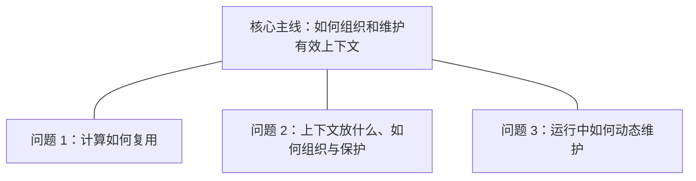

# AI 提炼：围绕问题组织局部结构图

日期：2026-09-27  
状态：方案设计，供评审；本轮不实施代码、数据库或模型调用。  
验收资料：[ai-agent-book 第二章：上下文工程](https://github.com/bojieli/ai-agent-book/blob/main/book/chapter2.md)。

## 1. 目标与推荐方案

把阅读单位从“一个概念节点”提升为“一个需要回答的问题”。保留用户已经选择的结构图、阅读路线和详细说明组合，形成：

**核心主线 → 问题导航 → 当前问题的答案与局部图 → 节点、关系及原文依据。**

读者先知道文章解决哪些问题，再理解每个问题内部的关系；跨问题依赖通过有名称的引用保留。一篇文章可以只有一个问题，也可以包含多个问题，不固定为三个，不把所有节点放进默认视图。

本轮涉及生成结果契约、可编辑小结和阅读器之间的结构调整，属于产品架构设计。交付物就是本方案及其中的 DIFF，不额外生成实施计划。

| 路径 | 做法 | 收益与限制 |
| --- | --- | --- |
| **B：AI 识别问题，共享概念与关系，按问题展示局部图（推荐）** | 模型同时输出问题、答案、概念与视图归属 | 问题有原文依据，跨图含义一致；需要升级生成、保存和阅读契约 |
| A：前端拆分现有全文图 | 按节点角色或邻接关系切图 | 改动较小，但无法可靠推断作者回答的问题，容易把关联主题切散 |
| C：每个问题分别调用 AI 生成 | 先列问题，再独立生成多张图 | 适合以后深度学习模式；首版会增加延迟、重复定义和跨图矛盾的处理成本 |

推荐 B。多个问题的生成是同一次结构化输出中的逻辑步骤，不默认拆成多次模型请求。

## 2. 现状与问题

核对当前工作区后，确认以下边界：

- 生成结构只有一个 `coreQuestion`、一组全文 `nodes / relations` 和节点 `readingOrder`，没有独立的问题单元。
- `buildReadingChapters` 根据概念角色归成“对象与组成”“原理与机制”等阅读章节；它不是根据原文识别的实际问题。
- 点击阅读章节会改变选择状态，结构图仍包含全文节点。读者仍需从全图里寻找当前问题的答案。
- 小结以可编辑 Markdown `summary` 为唯一持久化内容，阅读器从中解析关系。新问题信息必须能随编辑、草稿与保存完整往返。
- 当前前端、领域校验、AI 返回值、数据库约束及部分 RPC 共同限制小结为 5000 字符，不能只改输入框。
- 当前关系提示词版本为 `knowledge-relations-v2`。既有任务保留自己的版本；新版验收必须创建新任务，不能把恢复旧任务当成重新生成。

因此，本次改动的中心是**生成的问题结构与阅读器一致**。局部图由模型给出明确归属，前端负责呈现与校验，不再靠角色猜问题。

## 3. 阅读结构与交互

### 3.1 文章总览

总览显示核心问题、一句话主旨，以及一组问题入口。每个入口包含问题标题、简短答案预览和它在主线中的作用。使用编号表示建议阅读顺序，不在问题之间默认画因果箭头。

上图只表达信息层级。问题之间若存在依赖、制约或对照，另显示“与其他问题的联系”，用短句说明；只有原文支持的语义关系才使用连线。

初次进入默认打开第一个问题，页面顶部仍可见文章主线和所有问题入口。一个问题的资料省去多问题导航，不制造空的第二层。

### 3.2 当前问题

桌面端沿用当前双栏：左侧约 60% 展示当前问题的局部图，右侧约 40% 展示详细内容。顶部依次是问题标题、直接答案和问题切换。

右侧初始显示“本题答案”：结论、关键解释、适用边界。点击节点后显示该概念在本题的作用；点击关系后显示关系命题、条件和依据。始终提供“回到本题答案”。

关系详情默认只列当前局部图的关系。其余联系放在明确的“跨问题联系”区域，防止全文关系通过侧栏重新涌入当前问题。

底部的“上一问题 / 下一问题”切换问题；图内的节点探索保留在当前问题内。两套状态分开记录，点一个旁支节点不会改变建议阅读进度。

### 3.3 一个问题包含多种机制时

每题默认一张局部图，优先控制在约 3–7 个可见节点；这是可读性目标，不是删除事实的硬指标。

如果一个问题需要多个不同视角才能解释，可在该题下增加最多三张具名视图，例如“按需载入 / 状态补充 / 历史压缩”。同一时刻只展示一张图，答案仍回答同一个父问题。不能用“视图 1、视图 2”等无意义名称。

只有“回答的是同一问题、解释视角不同”才增加视图；如果各部分有独立的学习目标与答案，应拆成平级问题。首版不做无限递归问题树。

### 3.4 跨问题引用

一个概念在全文只有一份定义、一个稳定标识和一个主要解释位置；在不同问题中可以有不同的上下文作用说明。

当前局部图只带入理解答案必需的外部概念，显示“引用自问题 1”等文字标记。点击时先在本题详情中解释当前关系，再允许跳转“查看完整解释”。返回时恢复原问题、原视图和选择位置。

例如，在历史压缩视图中，可以引用缓存复用概念解释“改写前缀可能影响复用”。无需同时展示缓存章节的全部推导过程。引用不会继续自动展开成一整张外部图。

### 3.5 移动端与可访问性

- 移动端先展示问题与答案，再展示可展开的局部图和下方详情；问题列表使用可换行入口，不能依赖悬停。
- 保留现有全屏阅读、键盘操作、关闭后的焦点恢复和浅深色主题。
- 切换问题后向辅助技术播报当前问题；选中状态同时使用文字或形状，不能只靠颜色。
- 局部图无法可靠布局或资料没有明确关系时，保留本题答案与关系列表，不强行输出一张误导性的图。

## 4. 用第二章示例说明

以下是基于用户学习目标建议的重组方式，不宣称原文目录恰好分为这三个问题，也不是本轮模型生成结果。正式验收允许语义相同的其他命名与合理拆分。

**核心问题建议：如何在计算成本、信息质量和窗口限制之间，组织并维护有效的 Agent 上下文？**

| 问题 | 直接回答的重点 | 局部图应突出什么 | 本题不展开什么 |
| --- | --- | --- | --- |
| 计算如何复用？ | 复用已经计算的状态，减少重复计算；说明复用条件 | KV Cache、Prompt Cache 的层次区别，前缀与失效边界 | 状态栏、Skills 和压缩方法的全部细节 |
| 上下文放什么，如何组织与保护？ | 给模型恰当的信息与规则，并区分指令和外部资料 | 系统提示词、工具定义、对话与工具返回的组成关系；提示设计与注入防御可分视图说明 | 各种动态维护策略的执行细节 |
| 运行中如何动态维护？ | 针对信息需求、状态变化、历史增长采用不同机制 | Skills 按需载入、状态栏补充、上下文压缩的作用对象与条件 | 再次完整解释缓存原理与所有上下文部件 |

问题 2 应区分概念组成与 API 载体：工具定义可以作为独立请求字段存在，不能误写成一种对话消息角色。问题 1 应区分 KV 状态复用与跨请求前缀缓存，不能把两者无条件等同。[原文参考](https://github.com/bojieli/ai-agent-book/blob/main/book/chapter2.md)

问题 3 的三条线索采用并列机制，不画成“Skills → 状态栏 → 压缩”的固定执行顺序。必要时分别进入三张局部图：

| 当前视图 | 主关系 | 需要时引入的跨题引用 |
| --- | --- | --- |
| 按需载入 | Skills 按任务需要载入相关内容 | 问题 2 的提示与内容组织 |
| 状态补充 | 状态栏显式补充运行状态信息 | 问题 2 的上下文内容 |
| 历史压缩 | 压缩处理增长的历史，同时保留关键任务信息 | 问题 1 的缓存复用边界 |

跨题联系显示为具体解释，例如“压缩如何影响缓存复用”，而不是笼统的“问题 1 关联问题 3”。该联系必须保留发生条件，并能查看原文依据。

全文覆盖检查还要考虑提示注入与安全边界、资料中的限定和研究性内容，不能为满足三个问题的外观而丢掉重要内容。研究探索可进入深入说明，不冒充默认工程实践。

## 5. 可复用的生成规则

统一原则：**先找问题，再写答案；按答案组织关系，按关系选择图形；共享概念，按需引用。**

### 5.1 如何识别问题

1. 提炼全文核心问题与直接回应它的主旨。多主题资料可以说明它们围绕的共同目标，不强造唯一因果主线。
2. 找出读者需要解决的独立疑问。一个问题应有明确对象、独立答案和可定位的原文依据；标题要能直接提问，不只是术语名称。
3. 合并答案实质相同的问题；拆开需要不同解释才能回答的问题。不能仅按章节、节点角色或平均节点数量切块。
4. 默认优先生成 2–5 个问题；简单材料允许 1 个。首版保护上限为 6 个，数量服从资料，不填满名额。
5. 明确问题范围和与主线的联系。章节只用于证据定位，不能直接替代问题识别。

### 5.2 每类问题如何组织

| 内容类型 | 先生成什么 | 优先采用的局部结构 | 避免的误导 |
| --- | --- | --- | --- |
| 概念与边界 | 定义、特征、适用与不适用范围 | 概念与边界对照 | 把特征写成因果 |
| 组成与分类 | 整体、部件或类别，以及各自职责 | 组成树或分类树 | 混淆“由什么构成”和“分哪些类” |
| 运行机制与流程 | 输入、处理、判断、输出、反馈 | 流程图或反馈图 | 把建议阅读顺序当运行顺序 |
| 原理与因果 | 前提、作用过程、结果、限制 | 有条件的因果链 | 把相关性或先后顺序当因果 |
| 问题与解决方案 | 问题、约束、方案、作用对象、代价 | 问题与方案分支图 | 机制没有作用对象，或收益没有条件 |
| 对比与选型 | 相同比较维度、差异、适用条件 | 并列对照或比较表 | 凭空选出绝对优胜者 |
| 方法与决策规则 | 条件、行动、检查和停止条件 | 决策树或行动流程 | 省略异常与停止条件 |
| 观点与论证 | 主张、依据、反例、局限 | 论证关系图 | 把作者主张呈现为已证实事实 |
| 演化与历史 | 阶段变化及资料明确的驱动因素 | 时间线或演化图 | 给单纯时间相邻补上因果 |
| 案例与经验 | 背景、行动、观察结果、适用范围 | 案例路径与结论联系 | 从个案推出普遍规律 |

一个问题可混合内容类型，但一张图应只有一个主要表达任务。需要不同图形语法时拆视图。没有可支持的关系时使用答案与概念列表。

### 5.3 生成与校验顺序

同一次结构化生成按以下逻辑组织输出，不要求返回模型内部推理：

**资料覆盖 → 主线与问题 → 每题答案 → 共享概念与关系 → 局部视图归属 → 跨题联系与阅读顺序。**

应用负责确定性校验：标识唯一、引用有效、边的端点可见、阅读顺序无重复、每题有答案与依据、每个核心概念有归属、每条核心关系至少进入一个视图或跨题联系、包含与分类关系不成环。证据应能在抓取的原文中匹配。

语义质量还需模型自检与人工验收：问题是否独立、答案是否直接、机制是否连到正确对象、关系是否真的被证据支持、是否遗漏关键主题。不能把“原文能匹配某个短句”当成事实关系已被证明。

保留当前提示词的信任边界：资料仅提供事实，网页内的指令不得改写生成规则。用户提炼要求可以调整重点和深浅，但不能改变事实与必要关联；空要求按完整资料覆盖。聚焦局部时明确写出整理范围。

校验失败时沿用有界修复，不删除必要对象来凑通过。超过容量仍无法完整表达时提示缩小资料范围，不截断为看似成功的结构。

## 6. 数据与持久化设计

### 6.1 推荐结构契约

保留共享的概念与关系，增加“问题与局部视图”这一层。以下为字段设计，不是本轮代码改动：

| 对象 | 主要字段 | 职责 |
| --- | --- | --- |
| 全文结构 | `schemaVersion`、`coreQuestion`、`thesis`、`questions`、`questionOrder`、`nodes`、`relations`、`questionLinks` | 保存文章主线与统一事实 |
| 问题 | `id`、`title`、`answer`、`scope`、`mainlineRole`、`evidence`、`views` | 给出独立问题、直接答案、范围、主线作用和依据 |
| 局部视图 | `id`、`title`、`diagramKind`、`nodeIds`、`relationIds`、`referenceNodeIds`、`readingOrder` | 明确哪些节点和边在本图中出现 |
| 概念 | 现有概念字段，加 `id`、`homeQuestionId` | 保留唯一解释与主要讲解位置 |
| 概念关系 | 现有关系字段，加 `id`，端点改用稳定概念 ID | 统一语义、条件与依据 |
| 跨题联系 | `fromQuestionId`、`toQuestionId`、`label`、`relationIds` | 把已有概念关系概括成问题间联系；不另造事实 |

局部视图的节点使用可附带 `contextNote` 的引用，说明该概念在本题的作用，不重复定义。`referenceNodeIds` 是可见节点的子集，用于标记外部概念；关系两端都必须在当前视图的可见节点内。

`questionOrder` 只控制建议阅读；`questionLinks` 只表示由具体关系支撑的语义联系。并列问题允许没有跨题连线。关系型数据中的引用方向沿用现有规范，不能为顺应从左到右的布局而反转含义。

新结构建议使用显式版本 `schemaVersion = 2`，生成提示词使用新版本 `knowledge-questions-v1`。现有无版本关系结构按旧格式解析，不能与新版本混淆。

### 6.2 继续使用可编辑小结作为唯一事实来源

首版仍保存一份 Markdown 小结，增加可逆的问题与视图章节。保留概念和关系的统一定义区，问题区只保存引用与本题说明；避免每张图重复一份全文解释。

建议文档顺序为：主旨 → 核心问题 → 问题导航 → 各题答案与视图引用 → 统一概念与关系 → 必要辨析 → 复述问题。格式版本明确写入结构标记。正文中的问题、概念和关系各有稳定标识，显示界面隐藏标识，只呈现自然语言。

结构标识统一使用 Markdown 表格的专用“标识”列，问题与视图的成员表引用这些标识，不依赖标题文本作为身份。修改显示名称不破坏引用；若用户手工删除标识或改出无效引用，阅读器降级展示完整文本并提示结构无法解析，不悄悄丢掉新增内容或显示旧图。首版不新增图形编辑器。

保存、草稿恢复、导入导出及派生功能都读取同一文档。任何解析失败都保留用户原文；不能用隐藏 JSON 覆盖用户已编辑的小结。

### 6.3 容量与数据库影响

**建议将小结保护上限统一从 5000 调整为 12000 字符。** 这是为问题答案、引用与结构格式预留空间，不是要求模型生成长文。目标仍是短答案、简洁关系和按需展开。

全文节点与关系建议保护上限同步由 16 / 24 调整为 32 / 48；单图仍优先 3–7 个可见节点。所有上限都是工程保护值，需要用真实输出校准，不能成为填满数量或删减主干的理由。总长度超限先去除重复解释与格式冗余，再尝试有界修复，禁止对结构文档直接 `slice` 截断。

需要同步的边界包括前端计数与输入框、领域 schema、解析器、AI provider 契约、worker 追加提醒逻辑、任务结果、保存 RPC、数据库检查约束，以及学习叙事等下游读取。提醒文字也计入总预算。

本方案需要后续数据库迁移，但主要是长度约束、RPC 校验和新任务的提示词默认版本；首版不新增独立的问题表。迁移先扩容并兼容旧格式，再启用新生成器；旧记录不改写。回滚生成器时保留已扩展的读取与容量支持，避免新记录无法打开。

### 6.4 旧记录、任务恢复与验收隔离

- 旧纯文本与旧关系结构继续按原有方式阅读。不能把旧前端分组伪装成模型新识别的问题。
- 只有用户主动重新提炼才生成新问题结构；不后台批量重跑历史资料。
- 重试同一个任务保留幂等性与原版本；主动重新提炼使用新的任务标识与新提示词版本。
- 本地草稿恢复和结果复用判定要区分资料链接、用户要求、生成版本和结构版本。若存在跨任务结果缓存，还必须绑定实际原文内容指纹，不能仅凭 URL 认为内容未变。
- 验收记录本次抓取时间、实际源内容指纹、任务 ID、提示词版本与实际模型调用。原文抓取失败时明确失败，不拿旧结果冒充本次生成。
- 模型服务商内部的前缀缓存命中不等于产品返回了旧总结；验收要证明发生了新的模型请求并使用本次原文。

## 7. 方案 DIFF

| 维度 | 当前方案 | 新方案 | 用户能感受到的变化 |
| --- | --- | --- | --- |
| 整理顺序 | 核心问题 → 全文概念 → 全文关系 | 主线 → 独立问题 → 每题答案 → 局部关系 | 先知道在学什么、为什么学 |
| 阅读导航 | 前端按角色推导章节 | AI 根据资料生成问题列表 | 导航标题就是实际疑问 |
| 结构图范围 | 同一张全文图，随选择高亮 | 当前问题或当前视图的局部图 | 同屏信息更少，关系更集中 |
| 详情默认态 | 从选中节点进入解释 | 先展示本题答案，再探索节点或边 | 不用点遍术语才能拼出结论 |
| 阅读顺序 | 节点级阅读路线 | 问题路线与图内探索分开 | 跳看细节后仍能回到主线 |
| 跨主题概念 | 全图直接连接 | 共享定义、局部引用、可往返跳转 | 简化画面，同时保留整体联系 |
| 内容类型 | 全文类型影响整体骨架 | 每题或每视图选择合适结构 | 组成、流程和对照不必挤成同一种图 |
| 数据契约 | 一组节点、关系及阅读顺序 | 新增问题、答案、视图引用与稳定标识 | 编辑和重开后问题结构仍在 |
| 保存容量 | 小结 5000 字符 | 建议统一扩为 12000 字符 | 问题层不会挤掉必要解释与条件 |
| 历史与缓存 | 原提示词任务和恢复机制 | 显式结构版本、新任务新生成、旧记录兼容 | 能分清旧记录与重新提炼结果 |
| 验收重点 | 图能显示、节点关系可点击 | 问题划分、局部闭合、跨题一致、原文覆盖 | 既检查可读性，也检查理解是否正确 |

对应实现影响范围如下，仅用于方案评估：

| 现有位置 | 后续需调整的内容 |
| --- | --- |
| `supabase/functions/_shared/ai/relation-prompt.ts` | 问题识别、直接答案、视图归属、跨题复用与覆盖规则 |
| `supabase/functions/_shared/ai/deepseek.ts`、`contracts.ts`、`runner.ts` | 新版本路由、结果校验、修复反馈、长度预算与提醒 |
| `lib/domain/knowledge-structure.ts` | 新结构契约、稳定引用、Markdown 往返与旧格式解析 |
| `features/checkins/structure-reader-model.ts` | 新结构使用显式问题与视图；旧结构保留旧阅读模型 |
| `knowledge-structure-view.tsx`、`knowledge-structure-map.tsx`、`knowledge-structure-detail.tsx` | 问题导航、局部图、答案默认态、跨题返回与图形布局选择 |
| `checkin-editor.tsx`、`knowledge-summary-view.tsx`、相关领域校验 | 新旧格式显示、保存与容量同步 |
| `app/knowledge-structure.css` | 问题导航、引用状态、桌面与移动端布局 |
| `supabase/migrations/` | 新建迁移扩容与更新新任务默认版本，不修改已执行迁移 |
| 现有单元、渲染和真实验收用例 | 问题契约、数据往返、跨图一致与阅读行为 |

## 8. 验收标准与首版边界

正式验收继续使用该第二章链接，**用户提示词为空**。必须从最新抓取的原文发起一次真实提炼；本文件里的问题示例不能作为隐藏用户要求或硬编码模板塞给模型。

| 验收项 | 通过标准 |
| --- | --- |
| 主线与问题 | 能识别计算复用、内容组织与动态维护这些不同学习目标；不要求逐字相同或固定三个问题 |
| 覆盖与边界 | 必要组成、提示设计、注入防御、Skills、状态补充与压缩均有合理位置；限定条件不丢失 |
| 局部性 | 进入任一问题，默认图只出现回答本题需要的节点与引用；不会仍显示全文图 |
| 关系准确 | 组成不冒充流程，阅读顺序不冒充因果；机制连接到具体作用对象 |
| 易混概念 | KV Cache 与 Prompt Cache 的解释不混层；工具定义不误写成消息角色 |
| 跨题联系 | 能从压缩查看缓存相关限制，再返回原问题；共享概念解释一致 |
| 直接答案 | 进入问题无需逐个点击节点，就能看到对该问题的清晰回答 |
| 保存与编辑 | 新结果保存、刷新、草稿恢复后不丢问题或视图；重命名不破坏引用；无效编辑完整降级为文本 |
| 兼容 | 旧纯文本和旧关系结构可打开，不被伪装为新版生成结果 |
| 真实生成 | 有新任务、新模型调用、本次原文指纹与新版本记录；不把旧任务结果当验收成功 |
| 布局与操作 | 桌面和窄屏无关键文字截断，键盘能切换与返回，引用不依赖颜色识别 |
| 通用性 | 另用简单单问题资料、比较型资料及无明确关系的资料检查，不把本章的三问模式写死 |

首版交付范围包括：问题级结构生成、局部图与必要图形类型、问题阅读路线、跨问题引用、持久化升级与旧格式兼容。全局自由画布、无限递归子问题、手动拖拽改图、每题单独模型调用与历史资料自动重跑不纳入本轮。

设计完成后的实施重点，应是验证“问题与答案是否清楚、局部图是否足够解释”，而非单纯追求节点和连线更少。
